# PS6 — App Flow / Navigation & User Journey Map

## Multimodal Industrial Safety & Hazard Monitoring System

**Document:** 03 — App Flow / Navigation & User Journey Map
**Source of truth:** `master_approach.md` (as amended 2026-09-28), plus decisions already frozen in `01_PRD.md` (product behavior) and `02_TRD.md` (technology choices — Firebase/Firestore/FCM backend, Next.js/React/Tailwind dashboard, cloud-hosted vision/decision compute).
**Revision note (2026-09-28):** Sections 8, 11–14, 17, 18, 19, 20, 24, and Journey 5 have been revised to remove the local ESP32 failsafe fallback, which no longer exists in the amended architecture. Emergency response now depends entirely on ESP32-to-backend connectivity.
**Scope:** every screen, navigation path, user action, system-generated event, and failure state needed to build connected screens rather than isolated pages.

### Decisions carried in from this document's grill session

| Decision | Resolution |
|---|---|
| Authentication | Real login via **Firebase Auth**. Gates the entire dashboard. |
| Role-based access | **None.** Login is identity/audit-only — every authenticated user reaches every screen, including Configuration. The three personas from the PRD differ in *why* they use the dashboard, not in *what* they can access. |
| Mobile scope | **Push notifications only** (FCM), deep-linking into the same responsive web dashboard. No separate mobile app or distinct mobile navigation structure — matches master_approach's diagram, which shows "Web Dashboard" and "Mobile FCM" as two separate outputs, not a mobile app. |
| Incident lifecycle (OPEN/ACKNOWLEDGED/RESOLVED) | **AppFlow-level extension, not in master_approach.** The source document never defines an incident status field, but Section 15 of this document's brief explicitly asks for review/acknowledge/resolve behavior, and a supervisor dashboard is not usable without some lifecycle. Marked wherever it appears. |

No automatic system actions are invented beyond what master_approach.md specifies (e.g. the system never auto-resolves an incident just because the underlying condition cleared — a supervisor must act).

---

## 1. System Users

| User | Primary reason they open the app |
|---|---|
| Safety Supervisor | Monitor facility safety, review/acknowledge incidents, review evidence |
| Facility/Operations Supervisor | Monitor zones, check network/hardware status, respond operationally |
| System Administrator / Technical Operator | Configure zones, cameras, PPE policy; monitor sensor node health |

All three log in the same way and reach the same screens (see decision table above). Full persona goals are defined in `01_PRD.md` Section 3 and are not restated here.

---

## 2. Entry Point

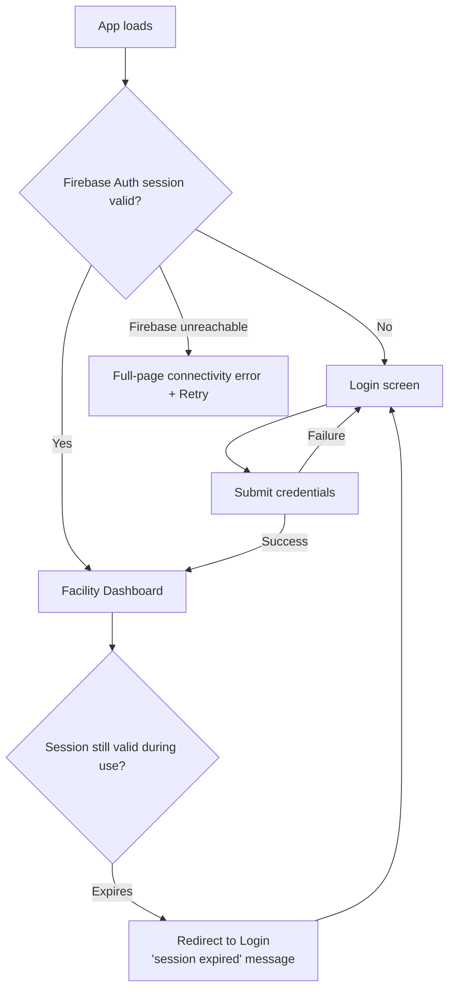

| Case | Behavior |
|---|---|
| Initial loading | App shell renders with a skeleton state while Firebase Auth resolves the current session. |
| Authentication | Firebase Auth (Section 17 of `02_TRD.md`). Exact sign-in method (email/password vs. SSO) is **TBD**, not frozen by master_approach — treat as a configurable auth provider setting. |
| Dashboard entry | On a valid session, land on Facility Dashboard (or a `returnTo` target if the user arrived via a deep link — see Section 22). |
| Unauthorized access | Any protected route hit without a valid session redirects to Login, preserving the intended destination as `returnTo`. There is no per-role "unauthorized" state, since access is identical once authenticated. |
| Session expiration | Firebase Auth token expiry redirects to Login with a "session expired" message. No destructive in-progress action exists to preserve — the dashboard is read/monitor-primary. |
| Network failure at entry | If the client cannot reach Firebase at all (e.g. loaded while offline), show a full-page connectivity error with a retry action — distinct from the in-dashboard "ESP32 connectivity degraded" state (Section 12/13), which is about the *ESP32's* LAN/cellular connection to the backend, not the *browser's* connection to Firebase. |

---

## 3. Page / Screen Inventory

| # | Screen | Purpose | Reachable pre-login? |
|---|---|---|---|
| 1 | Login | Firebase Auth sign-in | Yes (only screen) |
| 2 | Facility Dashboard | Facility-wide overview, landing page | No |
| 3 | Zone Overview | List of all configured zones | No |
| 4 | Zone Detail | Single zone's live state | No |
| 5 | Camera View | Single camera's live/recorded feed + AI overlay | No |
| 6 | Incident / Alert Center | List of incidents, filterable | No |
| 7 | Incident Detail | Full evidence + context for one incident | No |
| 8 | PPE Compliance View | Facility- or zone-scoped PPE compliance roll-up | No |
| 9 | Worker Detail | A tracked worker's recent PPE status/history | No |
| 10 | Event History | Facility-wide searchable event log | No |
| 11 | System Health | Rollup of all subsystem health | No |
| 12 | Sensor / Modbus Node Status | Per-node Modbus/sensor detail (drill-down from System Health) | No |
| 13 | Network Status | ESP32 LAN/Cellular/heartbeat detail (drill-down from System Health) | No |
| 14 | Configuration (hub) | Entry point to all configuration screens | No |
| 15 | Zone Configuration | Zone definitions, camera-to-zone mapping | No |
| 16 | PPE Policy Configuration | Per-zone required PPE items | No |
| 17 | Camera Configuration | Cloud-stream connection settings per camera | No |
| 18 | Notification Settings | Which event types/priorities trigger FCM push for this user | No |
| 19 | System / Device Details | Cloud vision service, ESP32, camera, and zone-node firmware/hardware identifiers | No |
| 20 | Error / Offline states | **Not a routed page** — a cross-cutting overlay/banner pattern applied within the other 19 screens (Section 20) | n/a |

No screen exists purely because the brief listed it without purpose — item 20 is intentionally *not* a standalone route; treating it as one would create a dead-end page nothing links to.

---

## 4. Main Navigation

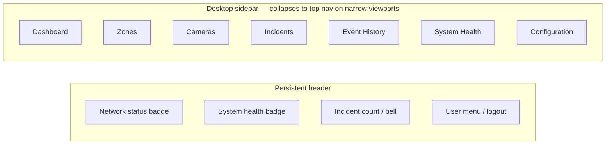

| Element | Behavior |
|---|---|
| Desktop navigation | Persistent left sidebar with the 7 top-level sections above |
| Mobile navigation | Same routes, sidebar collapses into a top hamburger menu at narrow viewports — no distinct mobile-only structure (per the mobile-scope decision) |
| Active page state | Current sidebar item highlighted |
| Back navigation | Browser back is sufficient; detail screens also carry an explicit "Back to [parent]" link |
| Breadcrumbs | Used on 3+ level drill-downs, e.g. `Dashboard > Zones > WELDING_ZONE > CAM_02` |
| Incident shortcuts | Header bell icon shows the open-incident count; clicking opens Incident Center filtered to status = OPEN |
| System health indicator | Header badge: green/yellow/red, linking to System Health |
| Network status indicator | Header badge (ESP32 connectivity): LAN / CELLULAR / OFFLINE (per `05_BACKEND_SCHEMA.md` §16 `current_mode`) |

---

## 5. Facility Dashboard Flow

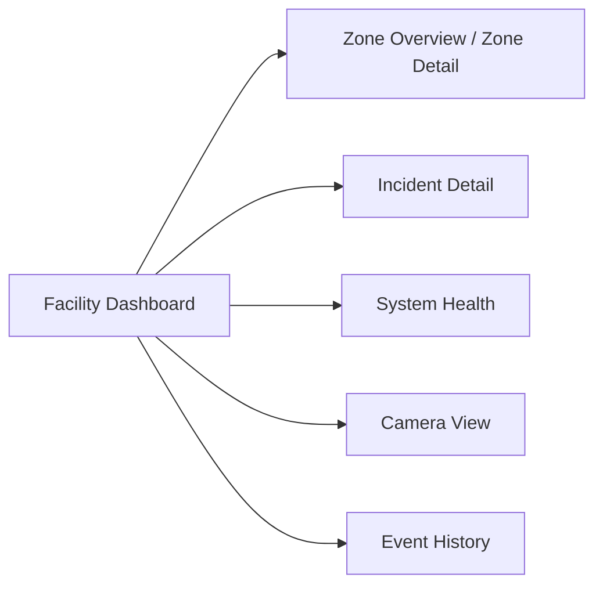

Facility overview widgets (per `01_PRD.md` §11): total cameras, active zones, current network mode, system health, active incidents. Each widget is a navigation entry point to its corresponding screen.

---

## 6. Zone Flow

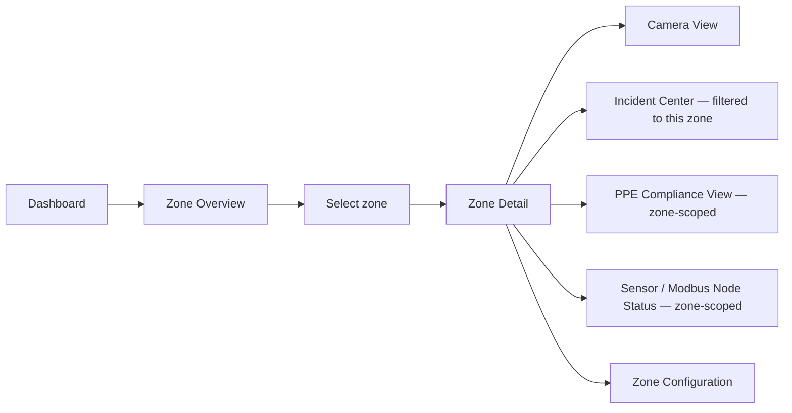

Zone Detail shows: zone name, camera, worker count, PPE compliance, fire state, smoke state, physical sensor state, sensor/node health (per `01_PRD.md` §11).

---

## 7. Camera Flow

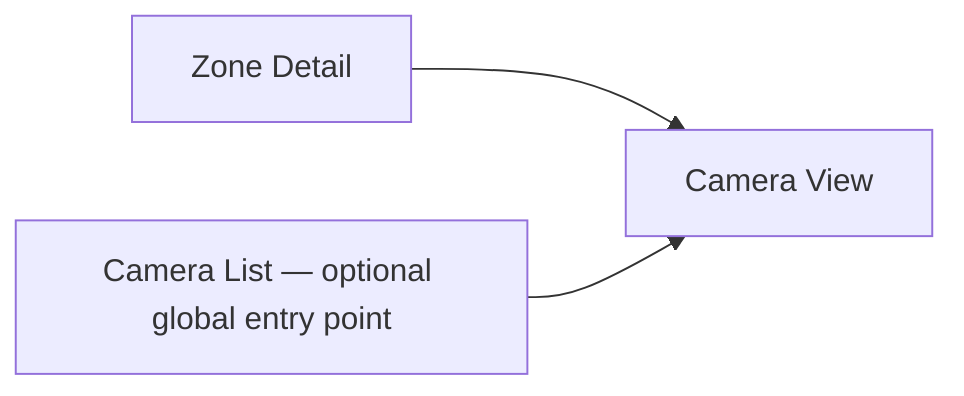

Camera View shows: camera ID, zone, live/recorded video, AI detection state, worker detections, PPE status, fire/smoke detections, camera health.

**Camera offline behavior:** the last known-good frame/thumbnail is shown with an "OFFLINE — last seen [timestamp]" overlay. The AI detection panel shows "No live inference" rather than displaying stale detection boxes as if current.

---

## 8. PPE Violation Flow

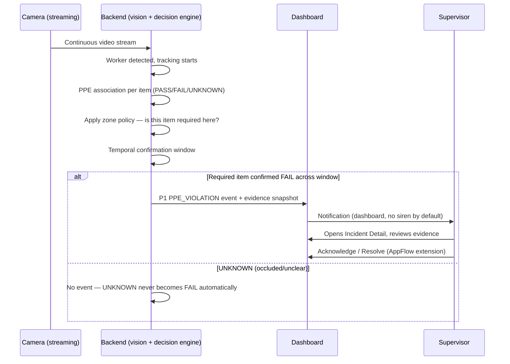

| Edge case | Behavior |
|---|---|
| Violation resolved (worker later shown PASS) | The system does **not** auto-close the incident — closing the underlying condition is not the same as a supervisor confirming it was addressed. The incident stays OPEN until a supervisor resolves it. |
| Worker leaves camera view | Tracking ends for that worker ID; any already-reported incident remains in history, unaffected. |
| Worker becomes occluded | The occluded item(s) evaluate to UNKNOWN, not FAIL — no new violation is raised from an occlusion alone. |
| Tracking lost / worker reappears | Reappearance is assigned a new tracker ID (no cross-session worker re-identification specified in master_approach) — noted as a known limitation, not silently assumed solved. |
| False/ambiguous detection | Supervisor can mark an incident as a false positive from Incident Detail (AppFlow extension — a minimal, necessary action for the incident list to stay usable; not a master_approach requirement). |

---

## 9. Fire / Smoke Flow (system-generated)

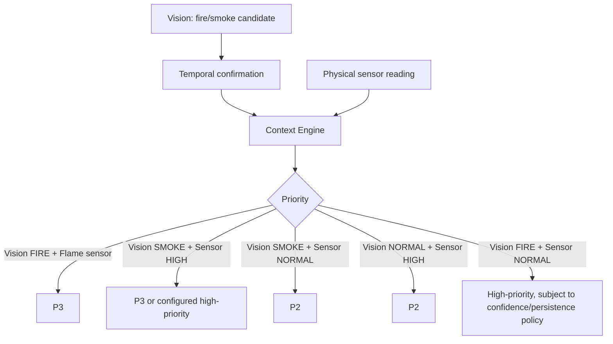

This is the same decision table as `02_TRD.md` §9, presented here as a navigable flow rather than repeated as a case table.

---

## 10. P2 Flow

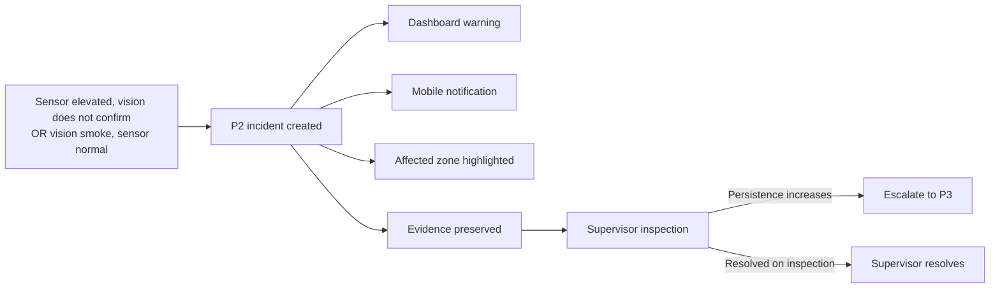

---

## 11. P3 Flow

**Revised 2026-09-28 — the local/cloud parallel path no longer exists.** All computation and the siren command originate from the backend; there is no independent local path.

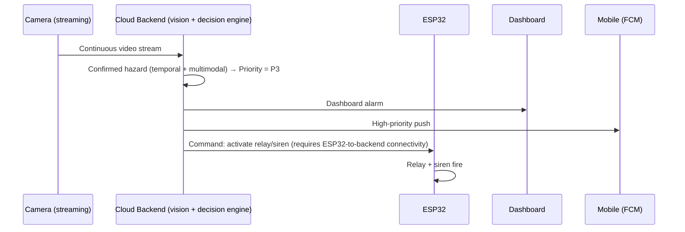

**The siren activation depends entirely on the backend reaching the ESP32.** There is no path where the siren fires without that command arriving — see Section 13.

---

## 12. Network Failover Flow

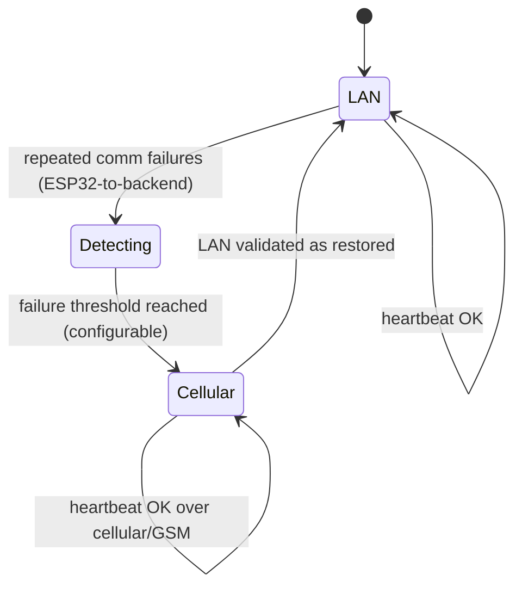

This failover applies to the ESP32's connection to the backend only (LAN/WiFi primary, cellular/GSM backup). Camera connectivity is independent — a camera has its own path to the backend and is not part of this failover state. Sensor telemetry generated while a transition is in progress is queued on the ESP32 and flushed once a path is available; a relay/siren command cannot be delivered during the transition window.

---

## 13. Complete Connectivity Loss Flow

**Revised 2026-09-28.** This section previously described a local ESP32 fallback. That fallback does not exist in the current architecture.

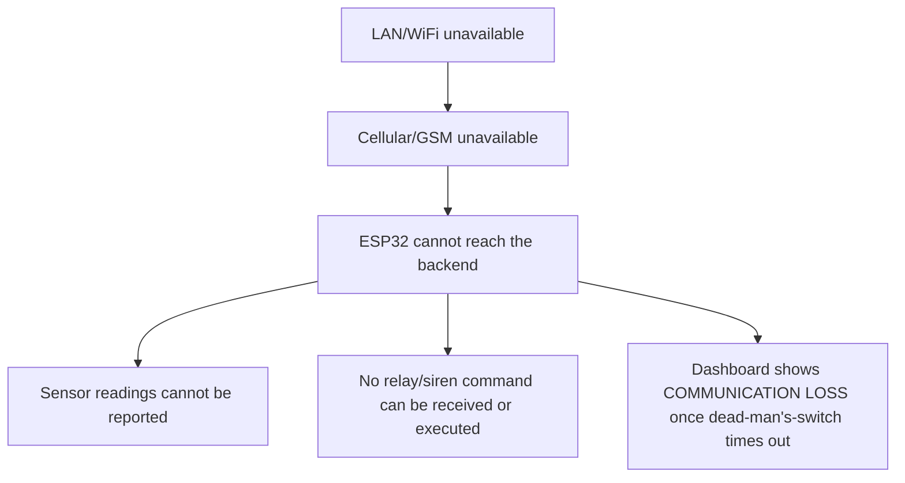

**Even if a physical hazard is genuinely occurring, the siren does not fire during total ESP32 connectivity loss.** This is a deliberate, accepted trade-off (see `01_PRD.md` §12, `02_TRD.md` §12.2) — not a gap this document works around. The dashboard's job in this state is to make the limitation visible (Section 20), not to imply a fallback is in progress.

---

## 14. Dead-Man's Switch Flow

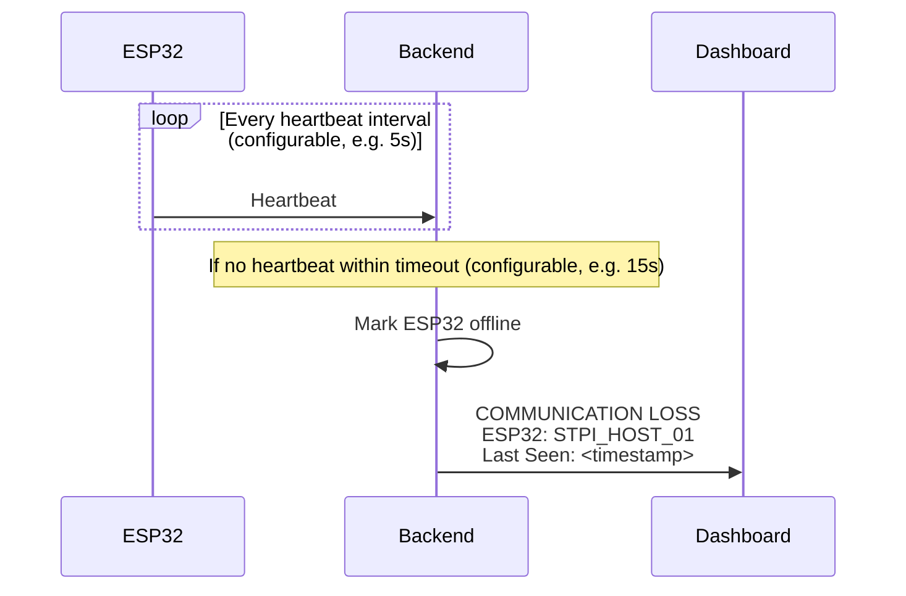

**This is no longer "just" a monitoring signal.** Because the ESP32 has no local decision authority (`02_TRD.md` §12), a dead-man's-switch timeout means emergency response is currently unavailable, not merely that a health metric has degraded. The dashboard must present this state accordingly (Section 20).

---

## 15. Incident Flow

**Incident Center (list):** priority, event, location, timestamp, confidence, status.

**Incident Detail:** event ID, event type, zone, camera, timestamp, confidence, AI evidence, physical sensor evidence, evidence image, required action, network mode.

**Incident lifecycle (AppFlow-level extension, not defined in master_approach.md):**

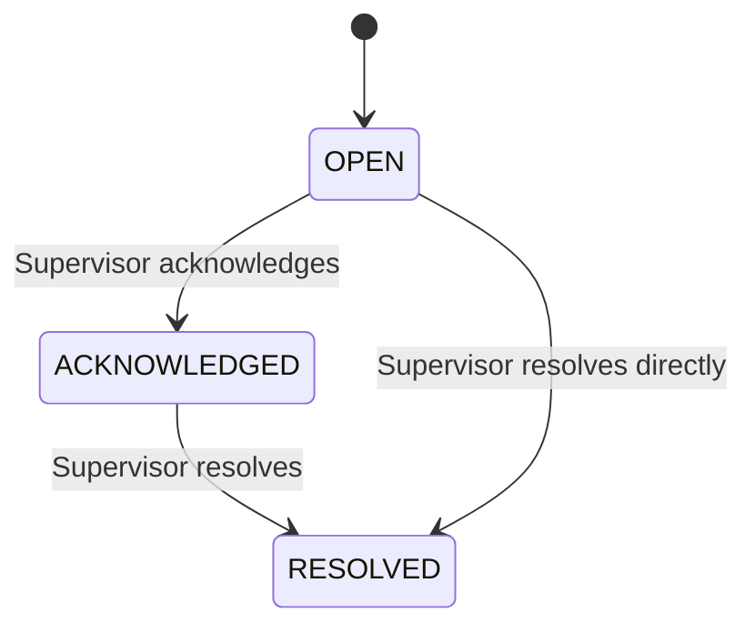

No automatic transitions exist — the system never moves an incident to ACKNOWLEDGED or RESOLVED on its own, even if the underlying condition clears, since master_approach never specifies that behavior and inventing it would hide real incidents from review.

---

## 16. Event History

Reviewable event types: PPE violations, smoke events, fire events, sensor alerts, network failures, heartbeat failures, system events.

**Filtering** by date/time, zone, camera, event type, and priority is a practical dashboard feature, not a core PS requirement — master_approach does not mandate filtering, but a facility-wide log is not usable without it at any real event volume.

---

## 17. System Health Flow

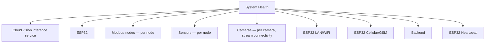

Each component reports ONLINE / OFFLINE / DEGRADED where applicable (DEGRADED e.g. a Modbus node responding but with a stuck heartbeat counter per `02_TRD.md` §11). Modbus node and sensor rows link through to Sensor/Modbus Node Status; ESP32 connectivity/heartbeat rows link through to Network Status. **The ESP32 row carries extra weight here** — since it has no local decision authority, ESP32 OFFLINE means emergency response is unavailable, not just that one subsystem is degraded (§14).

---

## 18. Configuration Flow

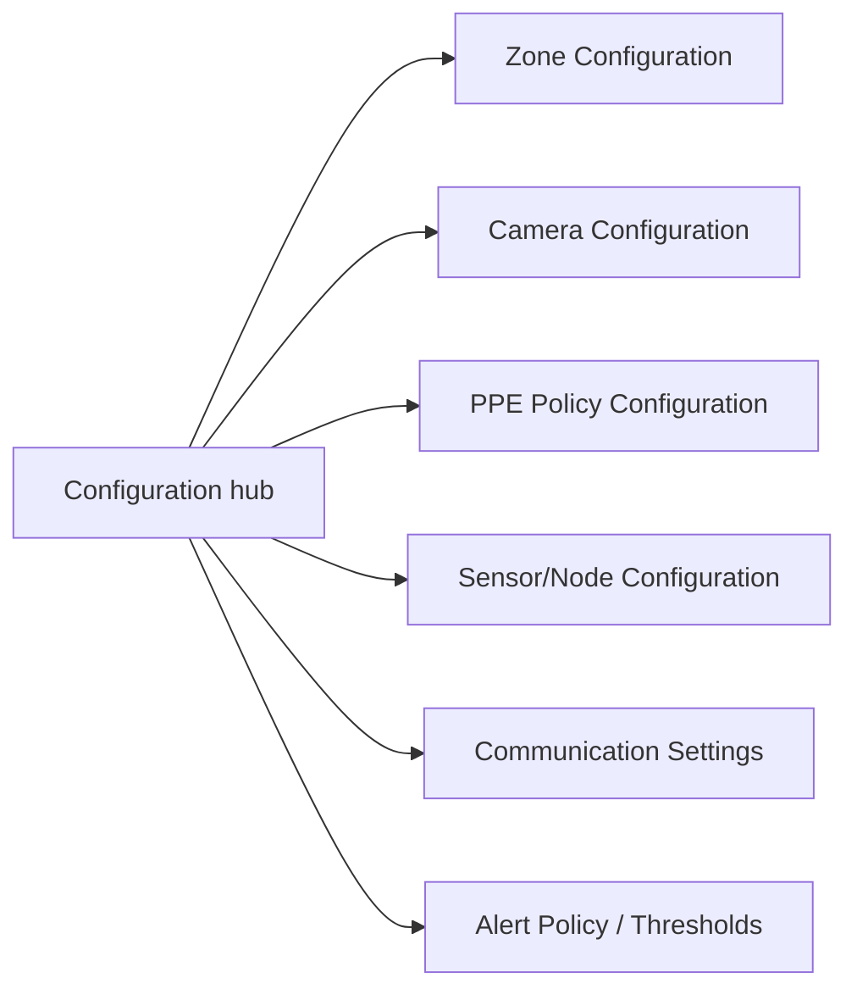

| Screen | Covers |
|---|---|
| Zone Configuration | Zone definitions, camera-to-zone mapping |
| PPE Policy Configuration | Per-zone required PPE items, e.g. `WELDING_ZONE: helmet=required, vest=required, gloves=required, safety_shoes=required` |
| Camera Configuration | Cloud-stream connection details per camera (camera must support native cloud push, not just local RTSP — `02_TRD.md` §13.1) |
| Sensor/Node Configuration | Modbus node addresses, per-node identification |
| Communication Settings | ESP32 LAN→Cellular failure threshold, heartbeat interval/timeout — all CONFIGURABLE per `02_TRD.md` |
| Alert Policy / Thresholds | Escalation confidence/persistence thresholds (`02_TRD.md` §7/§9), also CONFIGURABLE |

Since there is no role gating (Section 2), every authenticated user can edit configuration. A confirmation step ("this changes live zone policy") is a reasonable UX safeguard against accidental edits — not a security control.

---

## 19. Empty States

| Condition | Behavior |
|---|---|
| No cameras configured | Camera list/view shows a prompt to add a camera via Camera Configuration |
| No zones configured | Zone Overview shows a prompt to add a zone via Zone Configuration |
| No incidents | Incident Center shows "No incidents" (not an error) |
| No workers detected | Zone/Camera view PPE panel shows "No workers currently tracked" |
| No historical events | Event History shows "No events recorded yet" |
| No sensor data | Sensor/Modbus Node Status shows "Awaiting first reading" distinct from OFFLINE |
| No evidence image | Incident Detail shows a placeholder ("No image captured for this event") rather than a broken image |
| No active alerts | Header incident badge shows 0, no bell highlight |

---

## 20. Error States

| Condition | Behavior |
|---|---|
| Camera offline (stream interrupted) | Section 7 — last-known frame + OFFLINE overlay |
| Cloud vision inference service offline | Zone/camera views show "AI inference unavailable"; sensor-derived state (if any) still shown |
| ESP32 offline | System Health flags ESP32 OFFLINE; dashboard shows a persistent, prominent warning that **emergency response (relay/siren) is currently unavailable** — no local fallback exists |
| Modbus node offline | System Health / Sensor Node Status flags that node OFFLINE; last-known reading marked stale |
| Sensor failure (register 40004 = FAULT) | Node marked FAULT, distinct from OFFLINE |
| Backend unavailable | Dashboard shows a banner; ESP32-side sensor readings queue locally until a path is available (Section 12); camera streams simply fail to be received |
| ESP32 LAN unavailable | Network status badge (ESP32) → Cellular (if active) or degraded |
| ESP32 cellular unavailable | Network status badge (ESP32) → OFFLINE |
| Both ESP32 LAN and cellular unavailable | Network status badge → OFFLINE; COMMUNICATION LOSS banner once dead-man's-switch trips (Section 14); banner explicitly states emergency response is unavailable, not just "communication degraded" |
| FCM failure | Silent from the dashboard's perspective — the dashboard alarm (P2/P3) still fires; only the mobile push failed. No user-facing error needed for this alone. |
| Evidence upload failure | Incident Detail shows "Evidence unavailable — upload failed" rather than a broken image, distinct from "no image captured" (Section 19) |
| Invalid configuration | Configuration screens validate on save (e.g. a zone with no camera mapping) and block save with an inline error, not a silent failure |
| Authentication/session failure | Section 2 — redirect to Login with message |

---

## 21. Loading States

| Screen | Loading behavior |
|---|---|
| Dashboard | Skeleton widgets for each overview stat; populates as Firestore listeners resolve |
| Zone | Skeleton zone detail card |
| Camera | Video placeholder with spinner until first frame/stream connects |
| Incidents | Skeleton list rows |
| Event detail | Skeleton detail panel |
| System Health | Skeleton status rows, resolving per-component as each health check returns |
| Configuration | Skeleton form, disabled until existing config loads (never shows an empty form that looks like "no config exists" while still loading) |

---

## 22. Redirect Logic

| From | Condition | To |
|---|---|---|
| Any protected route | Not authenticated | Login (with `returnTo`) |
| Login | Auth success | `returnTo` target, else Facility Dashboard |
| Any protected route | Session expired | Login (with "session expired" message) |
| User menu | Logout clicked | Login |
| Dashboard | Zone widget clicked | Zone Detail |
| Zone Detail | Active incident clicked | Incident Detail |
| Incident Center | Row clicked | Incident Detail |
| Incident Detail | Evidence image clicked | Inline lightbox/expand — **not** a route change |
| Mobile push notification | Tapped, authenticated | Deep link to the relevant Incident Detail |
| Mobile push notification | Tapped, not authenticated | Login (with `returnTo` = that Incident Detail) |

Authentication is **not** configurable-off for this build (per the Section 2 decision) — this differs from the brief's default suggestion, and is called out explicitly since the brief assumed auth might be skipped entirely.

---

## 23. Core User Journeys

### Journey 1 — Supervisor checks facility health
1. Log in → Facility Dashboard.
2. Scans facility overview: network mode nominal, system health green, 0 active incidents.
3. Opens Zone Overview to spot-check a zone's live state without a specific trigger.
4. Returns to Dashboard. No further action needed.

### Journey 2 — Supervisor responds to a PPE violation
1. Header incident badge shows 1. Supervisor clicks it → Incident Center, filtered OPEN.
2. Opens the PPE_VIOLATION row → Incident Detail: worker ID, zone, missing item, confidence, evidence snapshot.
3. Reviews the evidence image, confirms it's a genuine violation.
4. Clicks Acknowledge, then follows up with the worker operationally, then returns and clicks Resolve.

### Journey 3 — Supervisor responds to a confirmed fire (P3)
1. Mobile push received: "P3 — CONFIRMED FIRE — WELDING_ZONE." Taps it.
2. Deep-links into Incident Detail (logging in first if the session had expired).
3. Sees vision confidence + flame sensor confirmation side by side, evidence image, required action `EVACUATE_ZONE`.
4. Confirms the siren already fired (system-generated, Section 11 — the backend's command reached the ESP32 successfully) — takes the operational evacuation action, then Acknowledges the incident on the dashboard once at a workstation.

### Journey 4 — Supervisor investigates a sensor-only hazard (P2)
1. Dashboard warning + mobile notification: gas/smoke sensor elevated, no visual confirmation.
2. Opens Incident Detail: sees `physical_sensors.smoke_index` elevated, `vision.smoke = false/absent`.
3. Opens the zone's Camera View directly from the incident to visually inspect in near-real-time.
4. If nothing visually confirms a hazard, resolves as a false alarm; if it escalates, the system auto-escalates to P3 (Section 10) and the supervisor is re-notified.

### Journey 5 — System handles total ESP32 connectivity loss during a physical hazard
*(System-generated — included for completeness of the flow, not a click-through. Revised 2026-09-28: this journey now demonstrates an accepted limitation, not a resilience capability.)*
1. LAN/WiFi drops. Dashboard network badge for the ESP32 → Cellular within the configured failure-detection window.
2. Cellular subsequently drops too. Badge → OFFLINE.
3. A flame sensor trips during this window. **The ESP32 has no local logic and cannot report the reading or receive a command — the siren does not fire.**
4. Once the dead-man's-switch timeout elapses, the dashboard shows COMMUNICATION LOSS for the ESP32, framed as "emergency response currently unavailable" (Section 14), not just a health metric.
5. Once connectivity is restored, the ESP32's queued sensor readings (polled locally throughout the outage but never reported) reach the backend. The backend evaluates them against current context and raises whatever priority is now warranted — there is no special "fallback" event type, since no fallback occurred. Any response during the outage itself had to be manual/on-site.

### Journey 6 — Administrator configures a zone's PPE policy
1. Configuration hub → PPE Policy Configuration.
2. Selects `OFFICE_ZONE`, currently all PPE items not required.
3. Changes `helmet` to required (e.g. a temporary maintenance activity in that zone).
4. Confirms the "this changes live zone policy" prompt, saves.
5. Returns to Zone Detail for `OFFICE_ZONE` and confirms the PPE compliance panel now reflects the new requirement.

### Journey 7 — Operator diagnoses a failed Modbus sensor node
1. System Health shows Zone 2's Modbus node as OFFLINE.
2. Opens Sensor / Modbus Node Status for that node: last successful poll timestamp, consecutive missed-poll count, last known register values (marked stale).
3. Distinguishes between two fault classes shown separately: a comms timeout (no response at all) vs. a "stuck heartbeat" (responding, but register 40005 not incrementing) — per `02_TRD.md` §11.
4. Goes on-site to physically inspect the node/bus connection; once restored, the dashboard reflects the node returning to ONLINE without any manual dashboard action required.

---

## 24. System-Generated Flows (no user click required)

| Trigger | Resulting chain |
|---|---|
| AI detection (frame-level) | Detection → tracking → temporal confirmation buffer updates |
| Temporal confirmation window satisfied | Candidate → confirmed detection, passed to decision engine |
| Decision engine classification | Vision + sensor + zone policy + persistence → priority assigned (P0–P3) |
| Event creation | Structured event written (Section 16 schema in `02_TRD.md`), evidence snapshot attached if vision-sourced |
| Notification | Dashboard update (Firestore listener push) + FCM push per priority rules (`01_PRD.md` §10) |
| Relay/siren activation | Decision-engine-commanded only — requires ESP32-to-backend connectivity; no fallback path exists (Section 13) |
| Heartbeat failure | Dead-man's-switch timeout → COMMUNICATION LOSS banner, framed as "emergency response unavailable" (Section 14) |
| ESP32 LAN→Cellular failover | Repeated comm failures → cellular activation → retry (Section 12) |
| Total ESP32 connectivity loss | LAN + cellular unavailable → sensor readings cannot be reported, no relay/siren command can be received or executed — **no fallback exists** (Section 13) |

None of these require a user to be looking at the dashboard for the underlying action to occur — the UI reflects state, it does not gate it. The one exception worth naming explicitly: unlike a typical background process, the relay/siren action is *not* guaranteed to happen regardless of what the UI shows — it depends on live connectivity, and the dashboard's job during an outage is to say so clearly, not to imply the system is still protecting the facility.
