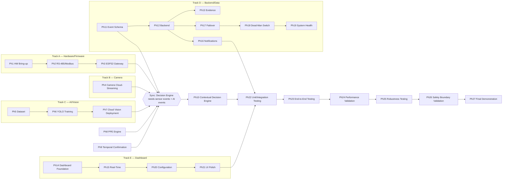

# PS6 — Implementation Plan

## Multimodal Industrial Safety & Hazard Monitoring System

**Document:** 06 — Implementation Plan
**Source of truth:** `master_approach.md` (as amended 2026-09-28), `PS6_Complete_BOM.md` (as amended), and `01_PRD.md`–`05_BACKEND_SCHEMA.md` (all revised 2026-09-28 to match the architecture amendment).
**Architecture this plan builds:** No Jetson/local edge-AI device. Cameras stream continuously to a cloud backend, which runs both vision inference and the contextual decision engine. The ESP32 is a Modbus-to-cloud sensor gateway and remote-commanded actuator with zero local decision authority — relay/siren activation depends entirely on ESP32-to-backend connectivity, with no local fallback.

### How this document is organized

Phase numbers below are kept as reference IDs consistent with the project's original phase brief, but **the real structure is a dependency graph across five parallel tracks**, not a strict 0→27 sequence — several phases have no real dependency on each other and can run concurrently across different team members (hardware/firmware, ML, backend, frontend, per the roles `01_PRD.md` §3 already defines). Sync points are called out explicitly wherever one track's output gates another's start.

---

## Prerequisite — Hardware Procurement (before Track A can start)

`PS6_Complete_BOM.md` confirms the team owns none of the hardware yet. Removing the Jetson from the BOM reduces the longest-lead-time item, but procurement is still a hard blocking dependency for **Track A only** — the AI/Vision, Backend, and Dashboard tracks need no physical hardware to begin.

| Item | Needed for |
|---|---|
| ESP32 DevKitC + GSM module (SIM7600/SIM800-class) | Track A |
| Arduino Nano **or** STM8-based boards ×2 (zone nodes) | Track A |
| RS-485 transceivers, flame sensors, MQ-series gas/smoke sensors ×2 each | Track A |
| Relay, siren, beacon, emergency push button | Track A |
| Cloud-push-capable IP cameras ×2 (see Phase 4 — selection criteria changed) | Track B |
| Power system, workshop tooling | Track A |

**Risk:** camera selection is now a harder constraint than the original BOM assumed (native cloud-streaming capability, not just RTSP) — vet specific camera models before ordering, not after. This is the single highest-risk procurement item in the revised architecture.

---

## Track Overview

**The single hard sync point:** Phase 10 (Contextual Decision Engine) cannot start until Track A (sensor events flowing from the ESP32), Track B (camera streams reaching the backend), and Track C (AI events being produced) all exist, plus the event schema (Phase 11) is frozen. Everything before that sync point can be built in parallel by different people. Everything after Phase 22 is sequential by nature (each testing phase needs the previous one's pass).

---

## PHASE 0 — Project Foundation

**Objective:** Repository/project structure exists before implementation begins.
**Dependencies:** None — first phase, blocks nothing hardware-related.
**Tasks:** Create repository; create the monorepo structure from `02_TRD.md` §20 (`backend/`, `firmware/`, `dashboard/`, `shared-schemas/`, `config/`, `tests/`, `docs/`); commit `01_PRD.md`–`05_BACKEND_SCHEMA.md` and `master_approach.md` into `docs/`; create environment variable templates from `02_TRD.md` §19; freeze the event schema (`05_BACKEND_SCHEMA.md` §10–14) and the Modbus register map (`02_TRD.md` §11).
**Files/modules affected:** Whole repo skeleton.
**Hardware affected:** None.
**Tests:** Repo exists, all directories present, CI (if any) runs against an empty scaffold without error.
**Done criteria:** All directories exist; architecture documentation is committed; register map and event schema are marked frozen in `docs/`.
**Known risks:** Low risk — mostly clerical. The one real risk is drifting from the frozen register map/event schema later without updating this document set; treat any change to either as requiring a new dated revision note, per the pattern established in `01_PRD.md`–`05_BACKEND_SCHEMA.md`.

---

# Track A — Hardware / Firmware

## PHASE 1 — Hardware Bring-Up

**Objective:** Verify every physical subsystem independently before integration.
**Dependencies:** Procurement (Prerequisite section above).
**Components:** ESP32 + GSM module, Arduino Nano/STM8 zone nodes ×2, RS-485 transceivers, flame sensors ×2, MQ-series sensors ×2, relay, siren, beacon.
**Tasks:**
1. Bring up ESP32 (flash a minimal Arduino sketch, confirm WiFi connects, confirm GSM module responds to AT commands and can establish a cellular data session).
2. Bring up each zone node MCU (Arduino Nano or STM8) independently — confirm it boots and can read its own sensors locally (no RS-485 yet).
3. Test RS-485 physical layer point-to-point (no Modbus protocol yet — just confirm signal integrity between ESP32 and one node).
4. Test flame sensor raw output on each node.
5. Test gas/smoke sensor raw output on each node.
6. Test relay switching (low-voltage demonstration load, per `01_PRD.md` §18).
7. Test siren activation via the relay.
8. Test GSM module: send a test payload to a known endpoint over cellular data, independent of the backend.
**Files/modules affected:** `firmware/esp32-gateway/`, `firmware/zone-node/` (bring-up sketches only, not final firmware).
**Hardware affected:** All of Track A's hardware.
**Software affected:** None beyond bring-up sketches.
**Tests:** Each subsystem produces expected raw output in isolation.
**Expected output:** A log/checklist confirming WiFi connects, GSM establishes a data session, each sensor produces a plausible raw reading, and the relay/siren physically activates on command.
**Done criteria:** Every hardware subsystem produces expected test output independently — nothing is integrated yet.
**Known risks:** GSM module power draw can brown out the ESP32 on transmit bursts if the power supply isn't sized correctly — verify this specifically during bring-up, not later. Cellular signal strength at the demonstration site is unverified until tested on-site.
**Rollback/recovery:** If a specific sensor unit is defective, swap for a spare — do not proceed to Phase 2 with a subsystem that hasn't independently passed.

---

## PHASE 2 — RS-485 / Modbus Network

**Objective:** Build the two-zone sensor network with the frozen register map.
**Dependencies:** Phase 1 complete for ESP32 and both zone nodes.
**Tasks:** Implement Modbus RTU on top of the RS-485 physical layer; assign unique addresses per node; implement the register map (`02_TRD.md` §11 — registers 40001–40005, data types and ranges as specified); implement ESP32-side round-robin polling; add 120 Ω termination at the two physical bus ends only; test node timeout (unplug a node, confirm the ESP32 detects it); test node recovery (replug, confirm it's picked back up); test the stuck-heartbeat fault class specifically (register 40005 not incrementing despite successful polls).
**Files/modules affected:** `firmware/esp32-gateway/modbus_master`, `firmware/zone-node/modbus_slave`.
**Hardware affected:** RS-485 bus, both zone nodes.
**Tests:** ESP32 correctly reads all 5 registers from both nodes; timeout and stuck-heartbeat fault classes are both independently detectable and distinguishable from each other.
**Done criteria:** ESP32 can reliably poll both zone nodes and detect node/sensor failures, distinguishing a comms timeout from a stuck-heartbeat fault (`02_TRD.md` §11).
**Known risks:** RS-485 bus noise/reflection if termination is wrong — verify with an oscilloscope or logic analyzer if polling is unreliable, don't just guess at timing fixes.

---

## PHASE 3 — ESP32 Sensor Gateway & Remote-Commanded Actuator

**Objective:** Make the ESP32 correctly relay sensor data to the backend and execute remote relay/siren commands — **and confirm it has no local decision logic of any kind.**
**Dependencies:** Phase 2 complete; Phase 12 (Backend, at least the ingestion endpoints) far enough along to accept test traffic.
**Tasks:** Implement sensor telemetry relay over HTTPS (LAN/WiFi primary, cellular/GSM backup — `02_TRD.md` §13.2); implement heartbeat reporting; implement the command-receive path (poll or persistent connection, `02_TRD.md` §13.2) and relay/siren execution on command; implement the LAN→cellular failover logic (Phase 17 dependency, can be stubbed initially).
**Critical test — deliberately a negative-result test:** with the flame sensor physically active, disconnect both the ESP32's WiFi and its GSM/cellular connection. **Confirm the relay/siren does NOT activate.** This is the expected, correct behavior in this architecture, not a failure — document it explicitly as a passing test, since it is easy to mistake for a bug during a demo if the team hasn't internalized this is intentional.
**Files/modules affected:** `firmware/esp32-gateway/`.
**Hardware affected:** ESP32, GSM module, relay, siren.
**Software affected:** Backend ingestion endpoints (Phase 12) for integration testing.
**Tests:** Telemetry reaches the backend over both LAN and cellular; a command sent from the backend triggers the relay within a measured latency; the negative-result test above passes (no activation under total connectivity loss).
**Done criteria:** ESP32 correctly relays sensor data and executes remote commands over both connectivity paths, and **verifiably takes no independent action of its own under any condition**, including a genuine physical hazard during total connectivity loss.
**Known risks:** The team must resist the instinct to "fix" the no-siren-under-outage behavior — this is the accepted architecture, not a bug. Document this prominently in the firmware code comments and in any demo script, given how counter-intuitive it is relative to typical safety-system design.

---

# Track B — Camera

## PHASE 4 — Camera Cloud-Streaming Pipeline

**Objective:** Select and connect cameras capable of streaming directly to the backend, and map them to zones.
**Dependencies:** Procurement; Phase 12 (Backend ingestion endpoint for camera streams) far enough along to accept a test stream.
**Tasks:** Select specific camera models confirmed to support native cloud-push streaming (RTMP push or a vendor cloud-streaming feature — `02_TRD.md` §13.1; this is a materially different selection criterion than the original BOM's "RTSP-capable, avoid closed cloud-only" guidance, now amended); connect camera 1 and camera 2; configure each camera's outbound stream target to the backend's ingestion endpoint; validate both streams arrive continuously; map camera → zone in configuration; implement camera health (`cameras/{camera_id}.status`/`last_seen`, `05_BACKEND_SCHEMA.md` §4); handle stream interruption (Section 7 of `03_APP_FLOW.md`); measure stream latency (capture-to-backend-arrival).
**Files/modules affected:** `backend/vision-inference/ingest`, `config/camera_zone_map`.
**Hardware affected:** Both cameras.
**Software affected:** Backend video ingestion.
**Tests:** Both streams arrive continuously at the backend; each is correctly attributed to its configured zone; a deliberate camera power-cycle is correctly reflected as OFFLINE within a measured detection window.
**Done criteria:** Both camera streams reliably reach the backend continuously and are correctly associated with zones.
**Known risks:** This is the highest procurement/technical risk in the revised architecture — verify a specific camera model's cloud-push capability with a live test stream *before* committing to purchase quantity, not after. Continuous streaming bandwidth cost/reliability at the demonstration site's actual internet connection is unverified until tested on-site.

---

# Track C — AI / Vision

## PHASE 5 — AI Dataset

**Objective:** Prepare data for the PPE/fire/smoke model. Unaffected by the architecture change — dataset needs are identical whether the model runs at the edge or in the cloud.
**Dependencies:** None — can start on day one, in parallel with Track A/B.
**Tasks:** Collect/prepare datasets for the 7 classes (Worker, Helmet, Safety-Vest, Safety-Shoes, Gloves, Fire, Smoke); annotate/verify labels; check class balance; split train/validation/test; define augmentation strategy; document dataset sources; ensure representative conditions (low/bright lighting, motion blur, occlusion, crowding, dust, steam, camera-angle variation, small/large fire, smoke without flame).
**Files/modules affected:** `backend/vision-inference/dataset/` (dataset lives with the vision service since it's what trains/serves it).
**Hardware affected:** None.
**Tests:** Dataset passes a class-balance check; a held-out validation split exists.
**Done criteria:** Dataset is usable for model training and evaluation.
**Known risks:** Unchanged from the original plan — dataset quality/representativeness is the dominant risk to model performance regardless of where inference runs.

## PHASE 6 — YOLO Training

**Objective:** Train and select the detection model.
**Dependencies:** Phase 5.
**Tasks:** Train YOLOv8n; evaluate precision/recall/mAP@50/mAP@50-95/F1; review confusion matrix; analyze false positives/negatives; evaluate YOLOv8s only if YOLOv8n's benchmarks justify the additional compute cost (do not assume YOLOv8s is automatically better — `01_PRD.md` §16); select the model based on benchmark results.
**Files/modules affected:** `backend/vision-inference/training/`.
**Hardware affected:** Training compute (a separate concern from the cloud inference deployment target — training can happen on any available GPU, not necessarily the same infrastructure that will serve inference).
**Tests:** Benchmark metrics recorded against the held-out test split.
**Done criteria:** A validated model is selected for deployment.
**Known risks:** Unchanged from the original plan.

## PHASE 7 — Cloud Vision Deployment

**Objective:** Deploy the selected model as a backend service that ingests continuous camera streams. **Materially different from the original plan** — no Jetson, no TensorRT.
**Dependencies:** Phase 6; Phase 4 (a live stream to test against).
**Tasks:** Export model to ONNX; deploy behind a GPU-backed inference service (`02_TRD.md` §2 — a provisioned GPU endpoint/container, not a serverless function); benchmark FPS and inference latency against the actual incoming stream resolution/framerate; measure memory usage; implement stream-to-frame preprocessing; implement detection output; implement object tracking (persistent worker ID across frames).
**Files/modules affected:** `backend/vision-inference/serving/`.
**Hardware affected:** None locally — this is a cloud compute provisioning task.
**Software affected:** The GPU-backed inference deployment itself (cloud provider-specific).
**Tests:** Real-time inference keeps pace with the incoming stream (no unbounded frame backlog); measured FPS/latency recorded.
**Done criteria:** Real-time inference works against the live camera stream with measured performance.
**Known risks:** **This is the plan's biggest unresolved cost/performance risk.** Continuous GPU-backed inference on two always-on video streams is materially more expensive to run than the original Jetson's one-time hardware cost, and cloud GPU inference latency/cost was not part of this session's grilling — flag this explicitly to the project owner before committing to a specific cloud provider/instance size, since it affects both the demonstration budget and the achievable end-to-end latency.

---

## PHASE 8 — PPE Compliance Engine

**Objective:** Convert raw detections into worker-specific PPE states. Unchanged in behavior from the original plan (`02_TRD.md` §4) — now executes inside the backend service from Phase 7 rather than on a Jetson.
**Dependencies:** Phase 7.
**Tasks:** Worker tracking; associate PPE detections with tracked workers; determine body-region visibility; implement UNKNOWN (never defaulted to FAIL); implement zone PPE policy lookup; implement persistence (Phase 9); generate PPE events (`05_BACKEND_SCHEMA.md` §11).
**Files/modules affected:** `backend/vision-inference/ppe_engine/`.
**Tests:** A worker with an occluded body region produces UNKNOWN, not FAIL; a worker in a zone where an item isn't required produces no event for that item.
**Done criteria:** A worker receives a correct PPE state based on configured zone policy.
**Known risks:** Unchanged from the original plan.

## PHASE 9 — Temporal Confirmation

**Objective:** Prevent single-frame false alarms. Unchanged in behavior from the original plan.
**Dependencies:** Phase 7 (for fire/smoke), Phase 8 (for PPE).
**Tasks:** Confidence threshold configuration; persistence counter; frame-history handling; apply to PPE violations, fire, and smoke.
**Done criteria:** Single noisy frames do not automatically create persistent incidents.
**Known risks:** Exact thresholds are TBD AFTER TESTING (`02_TRD.md` §7) — do not hard-code a guessed value as final.

---

# Track D — Backend / Data

## PHASE 11 — Event Schema

**Objective:** Freeze the structured event representation.
**Dependencies:** None — can start immediately, in parallel with Tracks A/B/C.
**Tasks:** Implement the event fields from `05_BACKEND_SCHEMA.md` §10–14 (`ai_events`, `ppe_events`, `hazard_events`, `decisions`, `incidents`) — note `LOCAL_FAILSAFE_TRIGGER` no longer exists as an event type.
**Done criteria:** Every meaningful system event can be represented consistently.
**Known risks:** Low — this is largely unchanged from the original design; the main risk is a team member building against a stale (pre-amendment) copy of the schema.

## PHASE 12 — Backend

**Objective:** Event ingestion and persistence.
**Dependencies:** Phase 11.
**Tasks:** Firestore setup (`05_BACKEND_SCHEMA.md` §2–20 — facility, zones, cameras, PPE policies, sensor nodes, sensors, AI/PPE/hazard events, decisions, incidents, evidence, notifications, heartbeats, network state, system health); implement the ingestion endpoints (`05_BACKEND_SCHEMA.md` §23 — sensor telemetry, heartbeat, network-state from the ESP32; direct internal writes from the vision inference service); implement Callable Cloud Functions (`acknowledgeIncident`, `resolveIncident`, `updatePpePolicy`, `updateCameraConfig`); implement Firestore Security Rules and audit-log triggers (`05_BACKEND_SCHEMA.md` §24); implement the three materialized-view triggers `05_BACKEND_SCHEMA.md` assumes exist — zone `current_priority` rollup (§3, on `incidents` writes), `system_health/current` rollup (§18, on `sensor_nodes`/`cameras`/`heartbeats`/`network_state` writes), and `network_state_history` append-on-change (§16).
**Done criteria:** The ESP32 can submit sensor telemetry, the vision service can write events, and the backend persists/retrieves both correctly.
**Known risks:** Getting the ESP32's ingestion auth (service credential, not user auth) wrong is a real security risk — verify this is not accidentally left open during early testing.

## PHASE 13 — Evidence Storage

**Objective:** Store incident snapshots.
**Dependencies:** Phase 12; Phase 7 (a real detection to capture evidence from).
**Tasks:** Capture evidence image at detection time (in the vision service); store to Firebase Storage with a metadata record (`05_BACKEND_SCHEMA.md` §15); retrieve securely via signed URL; handle upload failure distinctly from "no image captured" (`03_APP_FLOW.md` §19/§20).
**Done criteria:** An incident can display its evidence image.

## PHASE 16 — Mobile Notifications

**Objective:** FCM alerts per priority.
**Dependencies:** Phase 12.
**Tasks:** Implement FCM dispatch on P1/P2/P3 event creation (`05_BACKEND_SCHEMA.md` §19); P3 uses high delivery priority; notification content structure per `01_PRD.md` §10.
**Done criteria:** Controlled test events generate correct notifications.

## PHASE 17 — ESP32 LAN / Cellular Failover

**Objective:** Make the ESP32's connection to the backend resilient. **Scoped to the ESP32 only** — cameras have their own independent connectivity, not covered here.
**Dependencies:** Phase 3, Phase 12.
**Tasks:** Test: (1) LAN healthy; (2) LAN disconnected; (3) cellular becomes active; (4) backend communication resumes; (5) LAN restored; (6) ESP32 returns to LAN; (7) cellular disconnected while LAN is also down; (8) both unavailable — **confirm no relay/siren command can be sent or received, and this is correctly shown on the dashboard as "emergency response unavailable," not merely "degraded."**
**Done criteria:** ESP32 failover works correctly between LAN and cellular, and the dashboard correctly and visibly represents total connectivity loss as an emergency-response gap, not just a connectivity inconvenience.
**Known risks:** Do not hard-code the failure-count threshold before real network testing validates a sensible value (`02_TRD.md` §14).

## PHASE 18 — Dead-Man's Switch

**Objective:** Detect ESP32 communication loss.
**Dependencies:** Phase 17.
**Tasks:** Heartbeat generation (ESP32), storage, timeout detection, offline state, last-seen timestamp, dashboard indication (`05_BACKEND_SCHEMA.md` §17).
**Done criteria:** Backend identifies ESP32 communication loss within the configured timeout, and the dashboard presents this as an emergency-response availability signal, not a background health metric.

## PHASE 19 — System Health

**Objective:** Integrate health monitoring for the cloud vision service, ESP32, Modbus nodes, sensors, cameras, ESP32 LAN/cellular, backend, and heartbeat.
**Dependencies:** Phases 3, 4, 7, 12, 17, 18.
**Done criteria:** Dashboard reflects current subsystem health, with the ESP32 row visually distinguished as safety-critical (`04_UI_UX_DESIGN_BRIEF.md` §13/§18).

---

# Track E — Dashboard

## PHASE 14 — Dashboard Foundation

**Objective:** Build the supervisor dashboard shell and core views.
**Dependencies:** Phase 12 (backend schema/APIs to read against); Phase 11.
**Tasks:** Facility overview, Zone view, Incident panel, System health panel per `01_PRD.md` §11 and `04_UI_UX_DESIGN_BRIEF.md` §6–13; Event History screen (`03_APP_FLOW.md` §3 item 10, §16 — facility-wide searchable event log); Firebase Auth login (`03_APP_FLOW.md` §2, identity-only, no role gating).
**Done criteria:** Supervisor can understand facility state from the dashboard.

## PHASE 15 — Real-Time Events

**Objective:** Dashboard updates without manual refresh.
**Dependencies:** Phase 14, Phase 12.
**Tasks:** Firestore `onSnapshot` listeners for incidents, zone state, sensor state, network state, system health (`05_BACKEND_SCHEMA.md` §25).
**Done criteria:** New events appear in the dashboard with measured latency.

## PHASE 20 — Configuration

**Objective:** Zone/camera/PPE-policy/sensor/alert configuration without code changes.
**Dependencies:** Phase 14.
**Tasks:** Zone creation/configuration, camera-to-zone mapping (camera cloud-stream connection details, not RTSP — Phase 4), PPE policy, sensor/node configuration, alert/temporal thresholds, ESP32 LAN/cellular failover settings (`03_APP_FLOW.md` §18); Notification Settings screen (per-user FCM event/priority preferences, `05_BACKEND_SCHEMA.md` §20 `notification_preferences`); System/Device Details screen (cloud vision service, ESP32, camera, and zone-node firmware/hardware identifiers, `03_APP_FLOW.md` §3 item 19).
**Done criteria:** Core configuration does not require modifying application source code, and both Notification Settings and System/Device Details are reachable and functional.

## PHASE 21 — UI Polish

**Objective:** Apply `04_UI_UX_DESIGN_BRIEF.md` in full.
**Dependencies:** Phases 14, 15, 20.
**Tasks:** Responsive design, loading/empty/error states, accessibility, the P3 full-screen takeover pattern, the dark/light theme pair, shadcn/ui + Radix component foundation, and — critically — the revised communication-loss messaging that states plainly that emergency response is unavailable (no "still active" reassurance language anywhere).
**Done criteria:** All primary dashboard flows are usable on desktop and mobile-sized screens, and the emergency-response-unavailable state is unmistakable when it occurs.

---

## PHASE 10 — Contextual Decision Engine (Sync Point)

**Objective:** Combine AI events, sensor events, zone policy, confidence, temporal persistence, and event history into a priority decision — the single point where Tracks A, B, and C converge.
**Dependencies:** Phase 3 (sensor events flowing), Phase 4 (camera streams flowing), Phase 7 (AI events being produced), Phase 8, Phase 9, Phase 11 (event schema frozen).
**Tasks:** Implement the case table from `02_TRD.md` §9 (Vision FIRE + Flame sensor → P3; Vision SMOKE + Smoke HIGH → P3/configured; Vision SMOKE + Sensor NORMAL → P2; Vision NORMAL + Sensor HIGH → P2; Vision FIRE + Sensor NORMAL → high-priority subject to confidence/persistence); on a P3 decision, issue the relay/siren command to the ESP32 (Phase 3's command-receive path).
**Done criteria:** The system produces contextual decisions rather than simple OR logic, and a P3 decision correctly attempts to command the ESP32 (succeeding or failing depending on ESP32 connectivity, per the accepted architecture).
**Known risks:** This is the most logic-dense phase in the plan — budget real time for it, not just wiring. Escalation thresholds are TBD AFTER TESTING (`02_TRD.md` §9).

---

# Integration and Validation (sequential — each phase gates the next)

## PHASE 22 — Unit / Integration Testing

**Objective:** Test each subsystem independently before end-to-end testing.
**Dependencies:** Phase 10, Phase 16, Phase 21.
**Tasks:** AI (inference, tracking, PPE logic, fire/smoke logic); Firmware (Modbus, sensors, heartbeat, relay, siren, and specifically the no-local-fallback negative test from Phase 3); Backend (APIs, database, event ingestion, notification, evidence); Frontend (dashboard, incidents, zones, health, configuration).
**Done criteria:** Each subsystem passes its independent tests.

## PHASE 23 — End-to-End Testing

**Objective:** Run the full demonstration scenarios.
**Dependencies:** Phase 22.

**Scenario A — PPE violation:** Worker → tracking → persistent PPE violation → P1 → dashboard → evidence.

**Scenario B — Confirmed fire:** Vision fire + Flame sensor → P3 → dashboard → FCM → backend commands ESP32 → siren (requires ESP32 connectivity).

**Scenario C — Sensor-only smoke:** Sensor HIGH + visual fire absent → P2 → inspection alert.

**Scenario D — Visual smoke:** Visual smoke + physical sensor normal → P2 → verification alert.

**Scenario E — Total ESP32 connectivity loss (revised — this is now a negative-result test, not a resilience test):** ESP32 LAN and cellular both disconnected while a physical hazard is genuinely occurring → sensor reading cannot reach the backend → **no decision is made, no siren fires** → dashboard shows COMMUNICATION LOSS / emergency-response-unavailable once the dead-man's-switch times out. This scenario passes when the siren correctly does *not* fire — confirm the team runs and documents this as expected behavior, not as a defect.

**Done criteria:** All five scenarios produce their documented expected outcomes, including Scenario E's negative result.

## PHASE 24 — Performance Validation

**Objective:** Measure the metrics from `01_PRD.md` §16 / `02_TRD.md` §22 — no invented targets, measurement only.
**Dependencies:** Phase 23.
**Tasks:** AI (Precision/Recall/mAP@50/mAP@50-95/F1); Runtime (FPS, inference latency, end-to-end latency — now including camera-to-cloud upload time, a new factor versus the original edge-hosted design); Alerts (detection→dashboard, detection→FCM, detection→siren); Network (ESP32 LAN failover, cellular connection time, LAN recovery, heartbeat timeout).
**Done criteria:** All metrics are measured and recorded.

## PHASE 25 — Robustness Testing

**Objective:** Test under the visual/environmental conditions from `01_PRD.md` §16.
**Dependencies:** Phase 24.
**Tasks:** Low/bright lighting, motion blur, occlusion, crowding, dust, steam, camera angle variation, small/large fire, smoke without flame. Document failures and adjust thresholds/configuration based on evidence.

## PHASE 26 — Safety Boundary Validation

**Objective:** Verify the prototype boundaries from `01_PRD.md` §18.
**Dependencies:** Phase 25.
**Tasks:** Relay controls only a low-voltage demonstration load; no direct industrial machinery/mains/fire-suppression control; no real evacuation infrastructure claim; controlled test environment; system clearly labeled as a hackathon prototype. **Additionally, specific to the revised architecture:** verify the dashboard and any demonstration materials clearly and prominently disclose that emergency response has no independent local fallback — this is now a boundary-validation item in its own right, not just a technical footnote, given how far it departs from typical industrial-safety-system expectations.

## PHASE 27 — Final Demonstration

**Objective:** Prepare and run the controlled two-zone demonstration.
**Dependencies:** Phase 26.
**Demonstrate:** PPE violation; sensor-only hazard; visual smoke; confirmed fire (with siren firing, connectivity present); dashboard; evidence; FCM notification; ESP32 LAN→cellular failover; total ESP32 connectivity loss (siren correctly does *not* fire — presented as a deliberate design choice, not hidden from the audience); system health; event history.

---

## Final Definition of Done

The complete prototype is considered finished only when:

- Two-zone sensor network works (RS-485 Modbus, ESP32 as master).
- ESP32 correctly relays sensor data and executes remote relay/siren commands, and demonstrably takes no independent local action under any condition.
- Both cameras stream continuously and directly to the backend.
- Cloud vision inference detects all required classes on the live stream.
- Worker tracking works.
- PPE compliance works, including UNKNOWN handling.
- Zone PPE policies work.
- Fire/smoke detection works (vision + physical sensor).
- Temporal confirmation works.
- The contextual decision engine produces P0–P3 correctly, per the multimodal case table.
- Events are persisted; evidence is stored.
- Dashboard works, including real-time updates.
- FCM notifications work.
- ESP32 LAN→cellular failover works.
- Dead-man's-switch heartbeat works, correctly framed as an emergency-response-availability signal.
- **The system correctly and visibly declines to activate the siren when ESP32 connectivity is unavailable — this is verified as a passing negative-result test, not treated as a defect.**
- All five demonstration scenarios (including Scenario E's negative result) pass.
- Performance measurements are recorded.
- Safety prototype boundaries are respected, including clear disclosure of the no-local-fallback limitation.
